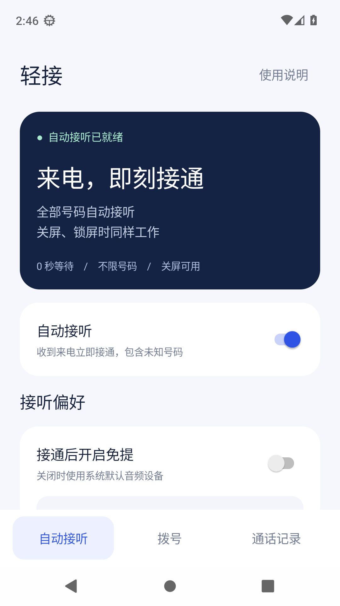

# AutoAnswerCalls · 轻接

安卓原生自动接听应用：**全部号码、无倒计时、关屏和锁屏时自动接听**。为中兴 / 努比亚 Z50、Android 13 的使用需求制作，最低支持 Android 10。

[下载 APK 测试版](https://github.com/vaseft/AutoAnswerCalls/raw/refs/heads/main/downloads/LightAnswer-1.0.0-debug.apk) · [实现原理](docs/architecture.md) · [权限说明](docs/permissions.md) · [测试记录](docs/testing.md)

## 功能

- 系统通知来电后立即请求接通，不设置延迟任务。
- 不按联系人或号码过滤，陌生号码、隐藏号码也参与自动接听。
- 接听逻辑在系统绑定的通话服务中执行，无需保持页面打开或屏幕常亮。
- 自动接听总开关，默认开启；接通后免提选项，默认关闭。
- 基础拨号、最近通话、手动接听、挂断、静音、音频选择、保持和通话拨号键盘。

「无等待」表示应用不添加倒计时；系统分发、进程启动和运营商接通仍需要时间，无法保证物理上的零毫秒。接通后由你本人通话，不包含 AI 代聊、录音或预录音播放。

## 安装与设置（Z50 / Android 13）

1. [下载 APK](https://github.com/vaseft/AutoAnswerCalls/raw/refs/heads/main/downloads/LightAnswer-1.0.0-debug.apk)，传到手机并按系统提示安装。安装包为开发签名测试版。
2. 打开轻接，点击「设为默认电话应用」，在系统弹窗中选择轻接。这会切换手机处理通话的默认应用。
3. 保持「自动接听」开启，允许通知权限；需要使用应用拨号或查看历史时，按提示允许相应电话 / 通话记录权限。
4. 点击「电池优化设置」，将轻接设为「不优化」或系统对应的不限制选项。若手机提供自启动、允许后台运行等选项，也为轻接开启。
5. 将手机关屏、锁屏，用另一部手机拨打本机 SIM 卡号码实测。

中兴官方的通用电池设置路径是「设置 → 电池 → 电池优化」，实际菜单可能随 MyOS 版本不同。参见[中兴后台运行说明](https://support.ztedevices.com/en-uk/why-do-background-programs-always-close/)。手机重启后先解锁一次；如果被系统强制停止，请重新打开应用。

暂停自动接听只需关闭开关。恢复原电话界面可到系统「默认应用 → 电话」选择原电话应用。

## 实现原理

用户授予默认电话角色 `RoleManager.ROLE_DIALER` 后，Android Telecom 在有通话时绑定 `AnswerService`（`InCallService`）。服务在 `onCallAdded()` 和通话状态回调中检查开关、默认电话角色和振铃状态，然后直接执行：

```java
call.answer(VideoProfile.STATE_AUDIO_ONLY);
```

接听判断不读取来电号码，也不依赖界面或屏幕状态。`answerAttempted` 集合防止对同一次来电重复请求接听。通话期间显示前台通知，通话结束后停止前台状态。[完整调用流程与源码位置](docs/architecture.md)

## 需要什么权限

**核心前提是用户把轻接设为默认电话应用。** 这是一项系统角色，不是普通权限弹窗。

| 权限 / 设置 | 用途 |
| --- | --- |
| 默认电话角色 `ROLE_DIALER` | 让系统把来电交给本应用的通话服务处理 |
| `CALL_PHONE` | 从应用拨号页面发起电话 |
| `READ_CALL_LOG` | 显示最近通话；不用于决定是否自动接听 |
| `POST_NOTIFICATIONS` | Android 13+ 的来电 / 通话通知和操作入口 |
| `USE_FULL_SCREEN_INTENT` | 手动处理来电时显示来电界面；自动接听逻辑不依赖它 |
| `FOREGROUND_SERVICE` | 通话期间的前台服务与通知 |
| `FOREGROUND_SERVICE_PHONE_CALL` | Android 14+ 的电话类型前台服务声明 |
| 服务上的 `BIND_INCALL_SERVICE` | 限制谁能绑定通话服务；由系统持有，不需要用户手动授予 |

本应用未声明联网、通讯录、录音、无障碍或悬浮窗权限。音频通话由系统电话栈处理，应用不采集或保存通话音频。[权限类型、拒绝后的影响和系统版本差异](docs/permissions.md)

## 适用范围与验证情况

处理 Android Telecom 交付的系统电话来电；不支持微信 / QQ 等未接入该接口的应用内语音，也不能接听已被运营商或系统提前拦截的来电。双卡、蓝牙、来电等待等行为仍受系统、硬件与运营商能力影响。

2026-11-13：Android 13 / API 33 模拟器的亮屏、关屏、进程回收、深度休眠、PIN 锁屏、关闭开关、重新启用 **7 项测试全部通过**；另在 API 37 模拟器验证相同核心场景。4 项策略单元测试通过，Android Lint 为 0 错误。**尚未在 Z50 真机和真实运营商线路上验证。** [详细测试记录](docs/testing.md)



## 从源码构建

需要 JDK 17、Android SDK 36 和 Build Tools 35.0.0。工程使用 Android Gradle Plugin 8.10.1、Gradle Wrapper 8.14.3，无运行时第三方依赖。

```powershell
git clone https://github.com/vaseft/AutoAnswerCalls.git
cd AutoAnswerCalls
.\tools\build.ps1
# SDK 不在默认位置时：
.\tools\build.ps1 -SdkPath 'D:\Android\Sdk' -BuildRoot 'E:\LightAnswerBuild'
```

脚本使用独立构建目录，避免部分 Windows JDK 在中文路径下的测试类加载问题，安装包输出到本地 `output/`。也可用 Android Studio 打开工程，配置本机 SDK 后构建。Linux / macOS 可执行：

```sh
chmod +x gradlew
./gradlew :app:assembleDebug :app:assembleDebugAndroidTest :app:testDebugUnitTest :app:lintDebug
```

标准构建的应用 APK 位于 `app/build/outputs/apk/debug/app-debug.apk`。测试 APK 仅用于模拟器验证，手机日常使用只需安装应用 APK。已上传安装包的摘要见 [SHA256SUMS.txt](downloads/SHA256SUMS.txt)。

## 文档与源码入口

- [实现原理与关屏接听机制](docs/architecture.md)
- [完整权限说明](docs/permissions.md)
- [测试记录与复现方法](docs/testing.md)
- [核心接听服务](app/src/main/java/cn/lightanswer/app/AnswerService.java)
- [接听条件](app/src/main/java/cn/lightanswer/app/AnswerPolicy.java)
- [AndroidManifest.xml](app/src/main/AndroidManifest.xml)
