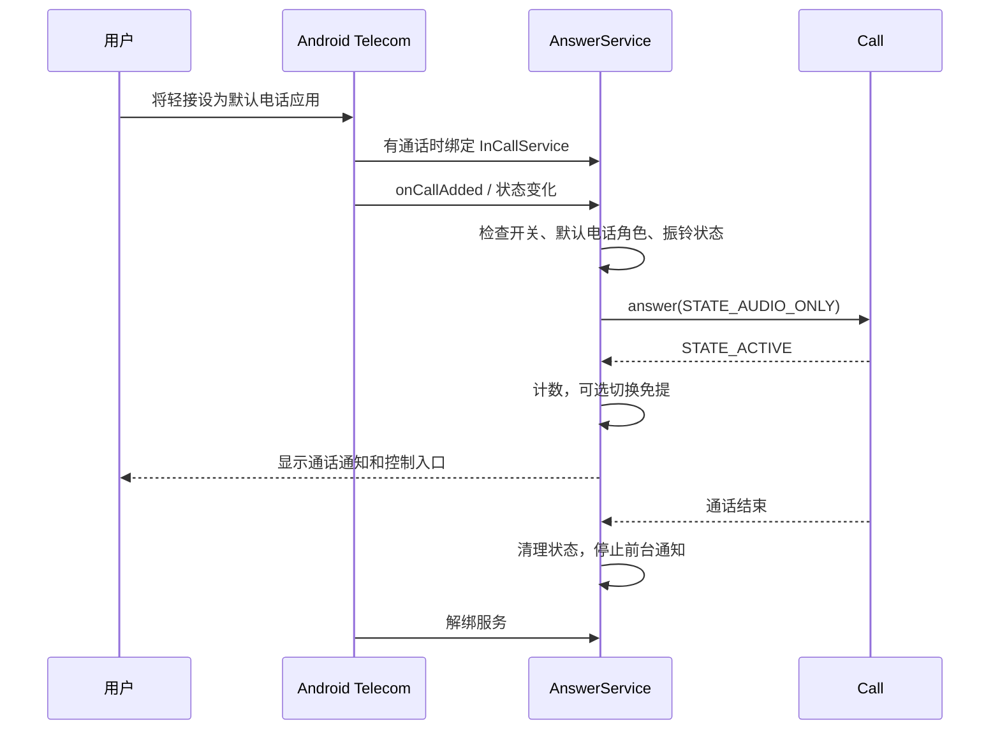

# 实现原理

轻接使用 Android 的默认电话应用接口处理系统通话。通话连接和音频由系统电话栈及运营商完成，应用负责接听请求、通话控制与界面。

## 调用流程

## 为什么必须设为默认电话应用

`MainActivity.requestDefault()` 通过 `RoleManager.createRequestRoleIntent(ROLE_DIALER)` 打开系统选择界面。应用声明了带 / 不带 `tel:` 数据的 `ACTION_DIAL` 入口，以及使用 `BIND_INCALL_SERVICE` 保护的通话服务，提供基础拨号与来电 / 通话界面。

取得默认电话角色后，Telecom 才会按该角色绑定应用的界面型 `InCallService`。自动接听前还会重新核对 `TelecomManager.getDefaultDialerPackage()`，避免角色已经被切换时继续请求接听。角色要求见 [Android 官方 InCallService 文档](https://developer.android.com/reference/android/telecom/InCallService#becoming-the-default-phone-app)。

## 怎样做到不添加等待

`AnswerService.onCallAdded()` 注册回调后立即调用 `autoAnswer()`；如果通话稍后才进入振铃状态，状态回调也会再次检查。`AnswerPolicy.shouldAnswer()` 只接受以下条件同时成立：

1. 自动接听开关开启。
2. 应用仍是默认电话应用。
3. 状态为 `STATE_RINGING` 或 `STATE_SIMULATED_RINGING`。

随后直接调用 `Call.answer(VideoProfile.STATE_AUDIO_ONLY)`。接听路径没有倒计时、定时器或号码查询。服务用集合记录已经请求接听的通话，避免多个状态回调重复调用。

系统确认进入 `STATE_ACTIVE` 后才增加成功接通计数。接口调用异常会记录日志并提供手动处理入口，不把发出请求直接当作已接通。接口说明见 [Call.answer](https://developer.android.com/reference/android/telecom/Call#answer(int))。

这不能消除系统来电过滤、服务绑定、进程启动和运营商接通的耗时。所谓「0 秒等待」是应用不人为延迟，并非零毫秒接通承诺。

## 为什么关屏、锁屏也能工作

接听代码在系统绑定的 `InCallService` 中运行，未放在 Activity 生命周期内，也不以屏幕是否点亮作为接听条件。页面退出或进程被回收后，在满足系统条件时 Telecom 可以重新启动并绑定服务。系统绑定服务的行为见 [InCallService](https://developer.android.com/reference/android/telecom/InCallService)。

自动接听不要求先打开 `CallActivity`，通常也不会为此主动点亮屏幕。代码中的 `PowerManager.isInteractive()` 仅决定是否主动打开部分通话界面，不决定是否接听。手动来电处理和用户主动打开通话界面时仍可能点亮屏幕。

通话期间使用 `phoneCall` 类型前台服务与通话通知；最后一个通话结束时停止前台状态，没有空闲时一直运行的前台保活服务。电话前台服务规则见 [Android 官方说明](https://developer.android.com/develop/background-work/services/fgs/service-types#phone-call)。

关屏接听仍受厂商后台策略影响。Z50 建议允许后台运行、自启动并将应用设为不优化。当前应用不支持在手机重启后的首次解锁前工作；系统强制停止后应重新打开应用。

## 为什么所有号码都能参与接听

自动接听条件没有联系人、白名单、来电号码或号码显示方式参数。号码只在通话界面和通知中用于显示，因此陌生号码、短号码、隐藏号码不会被应用主动排除。这里的「所有号码」限定为系统实际交给该服务的来电，不能绕过运营商或系统先行拦截。

## 音频、通知和数据

- 请求音频方式接听，不启动视频、录音或 AI 会话。
- 免提选项只在接通后调整系统音频路由。Android 14+ 使用 `CallEndpoint`；Android 13 等较旧版本使用 `CallAudioState` / `setAudioRoute()`。
- Android 12+ 使用 `Notification.CallStyle`；通知操作通过应用内广播接听或挂断。通知显示失败会被捕获，避免因此直接终止接听服务。
- 开关、免提选项和成功计数写入私有 `SharedPreferences`。最近通话界面读取系统 `CallLog`，最多显示 50 条，不另建号码数据库。
- 未声明 `INTERNET`、`RECORD_AUDIO` 或 `READ_CONTACTS`；没有云端接口或运行时第三方 SDK。

## 关键文件

| 文件 | 职责 |
| --- | --- |
| [AnswerService.java](../app/src/main/java/cn/lightanswer/app/AnswerService.java) | 接收系统通话事件、立即请求接听、管理通话和通知 |
| [AnswerPolicy.java](../app/src/main/java/cn/lightanswer/app/AnswerPolicy.java) | 与平台无关的接听条件，便于单元测试 |
| [MainActivity.java](../app/src/main/java/cn/lightanswer/app/MainActivity.java) | 默认电话授权、设置、拨号和通话记录 |
| [CallActivity.java](../app/src/main/java/cn/lightanswer/app/CallActivity.java) | 来电 / 通话界面、音频、静音、保持、拨号键盘 |
| [CallActionReceiver.java](../app/src/main/java/cn/lightanswer/app/CallActionReceiver.java) | 处理通知上的接听和挂断操作 |
| [SettingsStore.java](../app/src/main/java/cn/lightanswer/app/SettingsStore.java) | 本地设置和成功计数 |
| [AndroidManifest.xml](../app/src/main/AndroidManifest.xml) | 角色所需入口、通话服务与权限声明 |
